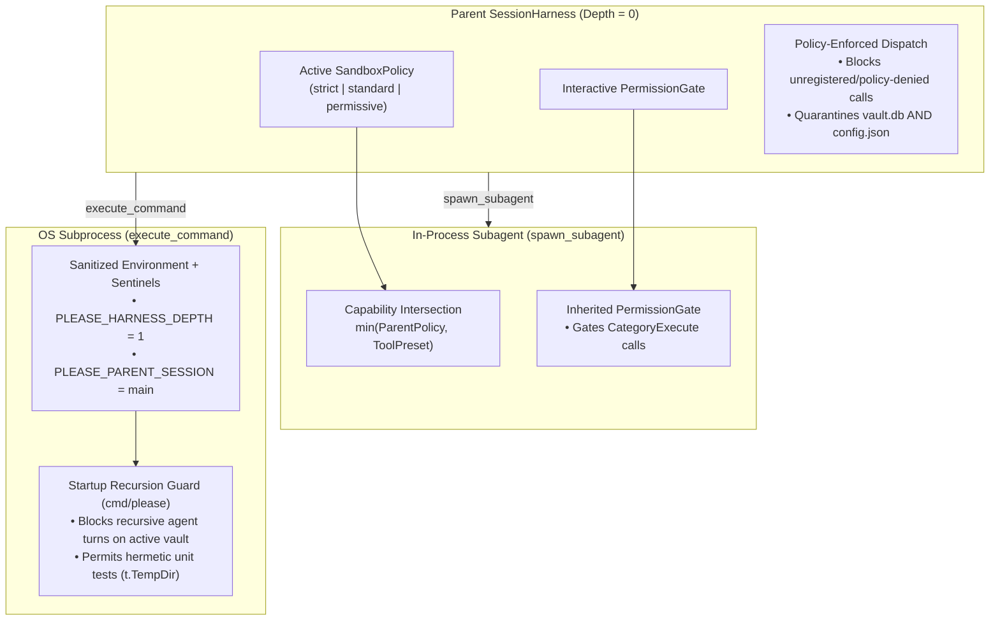

# ADR 023: Subprocess Recursion Guardrails, Policy-Enforced Dispatch, and Self-Hosting Isolation

## Status

Proposed

---

## Context

As `please` matures into a self-hosting agentic harness—where operators routinely wake an agent inside the `please` repository itself to perform security audits, run test suites, or inspect `internal/engine` and `internal/tools`—a subtle class of boundary vulnerabilities emerges at the intersection of **in-process sandboxing ([ADR 011](011-agent-sandboxing-execution-isolation.md))** and **delegated multi-agent topologies ([ADR 022](022-native-delegated-multi-agent-topologies.md))**.

### 1. The Out-of-Band "Inception" Fork Bomb (Process-Level Recursion)

In [ADR 022](022-native-delegated-multi-agent-topologies.md), in-process recursion is strictly capped at depth 1: `NewSubagentHarness` sets `IsSubagent: true` and omits `spawn_subagent` from the child's `ToolRegistry`.

However, when an agent (or subagent) operates with `execute_command` enabled, standard build tools (`go`, `make`) are permitted via `DefaultAllowedCommands` ([`internal/tools/exec.go`](../internal/tools/exec.go)). Because `sanitizeEnvironment()` currently strips all `PLEASE*` variables from subprocesses, a child subprocess has zero awareness that it was spawned inside an active `please` turn.

If an agent invokes `go run ./cmd/please ...`, `./bin/please ...`, or runs an un-isolated test via `execute_command`:
1. **In-Memory Guard Reset**: The child OS process boots with `IsSubagent == false`, regaining full access to `spawn_subagent` and `execute_command`—enabling an out-of-band recursive process tree bounded only by subprocess timeouts.
2. **Shared Vault Contention & Playhead Hijacking**: The child process opens the same workspace `.please/vault.db`. If it targets the default `"main"` session, it appends nodes and calls `SaveSessionHead("main", ...)` while the parent agent is still mid-turn waiting for `execute_command` to return, corrupting conversational lineage.

### 2. Self-Hosting Configuration Escalation (`.please/config.json`)

While [ADR 011](011-agent-sandboxing-execution-isolation.md) added `vault.db` to `SensitivePathPatterns` in [`internal/tools/sandbox.go`](../internal/tools/sandbox.go) to prevent direct database tampering, `config.json` was omitted. In `standard` mode (where file mutations are allowed without shell access), an agent can:
* Call `read_file(".please/config.json")` to inspect provider endpoints or stored credentials.
* Call `edit_file(".please/config.json")` to mutate `"sandbox_policy": "permissive"` or inflate `"max_tool_depth"`, escalating its own privileges on subsequent session boots.

### 3. Schema Filtering vs. Execution Dispatch Asymmetry

Currently, [`ToolRegistry.GetToolSpecsForPolicy`](../internal/tools/registry.go) filters the tool schemas sent to the LLM provider based on `SandboxPolicy` (`strict`, `standard`, `permissive`), while `RegisterDefaults` and `SpawnSubagent` still register `MutateTools` and `ExecTools` into the underlying `ToolRegistry.Tools` map.
* Because [`ToolRegistry.Dispatch`](../internal/tools/registry.go) looks up `r.Tools[name]` directly without re-verifying the active `SandboxPolicy`, a model that knows `execute_command` or `write_file` exists (for example, by reading `internal/tools/exec.go` during a self-hosted audit) can emit a raw `<call>execute_command...</call>` tag in its content stream (`ExtractContentToolCalls`) and execute a tool that was supposed to be disabled by policy.

### 4. Subagent Capability Ceiling & Gate Inheritance

In [`SubagentOrchestrator.SpawnSubagent`](../internal/engine/delegate.go):
* Requesting `tool_preset: "full"` (the default) registers `ExecTools` (`execute_command`) on the child registry even if the parent harness is operating under `standard` or `strict` policy.
* [`NewSubagentHarness`](../internal/engine/harness.go) initializes `PermissionGate: nil`. In `permissive` mode, approving a single `spawn_subagent` call at the parent level allows the child subagent to execute up to 25 `execute_command` shell invocations without interactive operator confirmation.

---

## Decision

We will harden the self-hosting and delegation security perimeter across `internal/tools`, `internal/engine`, and `cmd/please` through four deterministic mechanisms:



---

### 1. Cross-Process Recursion Sentinels (`PLEASE_HARNESS_DEPTH`)

To close the out-of-band OS process recursion loophole without breaking `go test ./...` for hermetic Living Scenarios ([ADR 015](015-living-scenarios-and-test-subsystem-decomposition.md)):

1. **Sentinel Injection in `execute_command`**:
   * [`sanitizeEnvironment`](../internal/tools/exec.go) continues to strip all host-inherited `PLEASE*`, `*KEY*`, `*SECRET*`, `*TOKEN*`, `*PASSWORD*`, and `*AUTH*` variables so secrets never leak.
   * Immediately before spawning `bash -c`, `ExecuteCommandTool` reads the current process's `PLEASE_HARNESS_DEPTH` (default `0`), increments it (`depth + 1`), and injects:
     * `PLEASE_HARNESS_DEPTH=<depth+1>`
     * `PLEASE_PARENT_SESSION=<sessionID>`
2. **Engine & CLI Enforcement**:
   * When `please` boots an interactive TUI, headless daemon (`please serve`), ACP server (`please acp`), or one-shot prompt execution against a workspace vault while `PLEASE_HARNESS_DEPTH >= 1`:
     * **Hard Recursion Ceiling**: If `PLEASE_HARNESS_DEPTH >= 1`, `SessionHarness` automatically treats the process as a leaf execution context (`IsSubagent = true`), refusing to register `spawn_subagent` or `execute_command` to guarantee a cross-process recursion ceiling of 1.
     * **Session Playhead Protection**: A process running with `PLEASE_HARNESS_DEPTH >= 1` is prohibited from mutating the session head matching `PLEASE_PARENT_SESSION` (e.g. `"main"`). Read-only diagnostics (`please inspect`, `please context`, `please memory`) remain fully operational.
     * **Hermetic Unit Test Exemption**: In-memory and `t.TempDir()` test harnesses (`go test ./...`) execute against ephemeral test vaults and mock providers, remaining completely unaffected.

---

### 2. Configuration Quarantine (`.please/config.json`)

We expand `SensitivePathPatterns` in [`internal/tools/sandbox.go`](../internal/tools/sandbox.go) to quarantine configuration files alongside `vault.db`:

```go
var SensitivePathPatterns = []string{
	".secrets",
	".env",
	".ssh",
	"id_rsa",
	"id_ed25519",
	"id_ecdsa",
	"id_dsa",
	".aws",
	".config/gcloud",
	".gnupg",
	"vault.db",
	"config.json", // Prevent agent from reading keys or escalating sandbox_policy/max_tool_depth
}
```

Any attempt by `read_file`, `write_file`, `edit_file`, `append_file`, `delete_file`, or `grep_search` to read or mutate `config.json` (whether in `.please/config.json` or `~/.please/config.json`) immediately aborts with a security violation error.

---

### 3. Dispatch-Level `SandboxPolicy` Enforcement

We eliminate the gap between **schema filtering** (`GetToolSpecsForPolicy`) and **tool execution** (`Dispatch`):

1. **Policy Check on Execution**:
   * `SessionHarness.ExecuteTurn` (and `ToolRegistry.DispatchWithPolicy`) validates every incoming `domain.ToolCall` against the active `SandboxPolicy` **before** invoking `tool.Function`.
   * Under `strict` policy, any tool with `Category != CategorySensory` is rejected at dispatch time with a deterministic security error, even if the model synthesized a raw `<call>...</call>` tag in its text stream.
   * Under `standard` policy, `execute_command` is rejected at dispatch time under all circumstances.

---

### 4. Subagent Capability Bounding & Gate Inheritance

Child subagents spawned via `spawn_subagent` ([ADR 022](022-native-delegated-multi-agent-topologies.md)) must never possess greater privileges than their parent session:

1. **Policy Ceiling Intersection**:
   * If the parent session's `SandboxPolicy` is `strict`, `SpawnSubagent` enforces `read_only` tools on the child regardless of the `tool_preset` argument.
   * If the parent session's `SandboxPolicy` is `standard`, `SpawnSubagent` may register `SensoryTools` and `MutateTools` (inside an isolated Git worktree), but **never registers `ExecTools` (`execute_command`)**.
   * `ExecTools` are only registered in a child subagent when **both** `parentPolicy == "permissive"` **and** `req.ToolPreset == "full"`.
2. **`PermissionGate` Inheritance**:
   * `NewSubagentHarness` inherits the parent `SessionHarness.PermissionGate` (wrapped with the child's `sub_<id>` session identifier) so any interactive `CategoryExecute` tool call (`execute_command`) inside a subagent still honors the operator's consent gate.

---

## Consequences

### Positive
* **Zero Cross-Process Fork Bombs**: Injecting `PLEASE_HARNESS_DEPTH` closes the out-of-band `go run ./cmd/please` recursion loop while keeping `go test ./...` Living Scenarios fast and hermetic.
* **No Self-Escalation via Config**: Quarantining `config.json` ensures an agent auditing its own repository in `standard` mode cannot rewrite its own `sandbox_policy` or `max_tool_depth` for future runs.
* **Defense-in-Depth Dispatch**: Enforcing `SandboxPolicy` at tool dispatch time neutralizes prompt-injected or raw `<call>` tag attempts to invoke unexposed tools.
* **Monotonic Subagent Privilege**: A child subagent is strictly a capability subset of its parent (`ChildPriv <= ParentPriv`), eliminating the `standard` $\rightarrow$ `full` privilege escalation seam.

### Negative / Trade-offs
* **Config Inspection Requires Operator CLI/Editor**: Because `config.json` is quarantined from agent file tools, the agent cannot directly read or edit `.please/config.json` on the user's behalf; operators manage configuration via `please init` or their editor.
* **Subagent Shell Gating in Permissive Mode**: When a subagent runs `execute_command` in `permissive` mode, the operator's `PermissionGate` will prompt for approval just as it does for the parent agent.

---

## Verification & Living Scenarios

1. **Quarantine Unit Tests (`internal/tools/sandbox_test.go`)**:
   * Verify `ValidateSafePath` blocks `.please/config.json`, `config.json`, and symlinked aliases across `read_file`, `write_file`, and `grep_search`.
2. **Dispatch Policy Unit Tests (`internal/tools/registry_test.go` & `internal/engine/harness_test.go`)**:
   * Verify that a model emitting raw `<call>execute_command...</call>` in `standard` mode or `<call>write_file...</call>` in `strict` mode is blocked at dispatch before tool execution.
3. **Subagent Capability Ceiling Tests (`internal/engine/delegate_test.go`)**:
   * Verify `spawn_subagent(tool_preset: "full")` under `standard` parent policy cannot execute `execute_command`, and that `PermissionGate` is invoked when `parentPolicy == "permissive"`.
4. **Subprocess Depth Sentinel Tests (`internal/tools/exec_test.go`)**:
   * Verify `sanitizeEnvironment` strips external `PLEASE_*` secrets while `ExecuteCommandTool` injects `PLEASE_HARNESS_DEPTH=1` and `PLEASE_PARENT_SESSION`.
