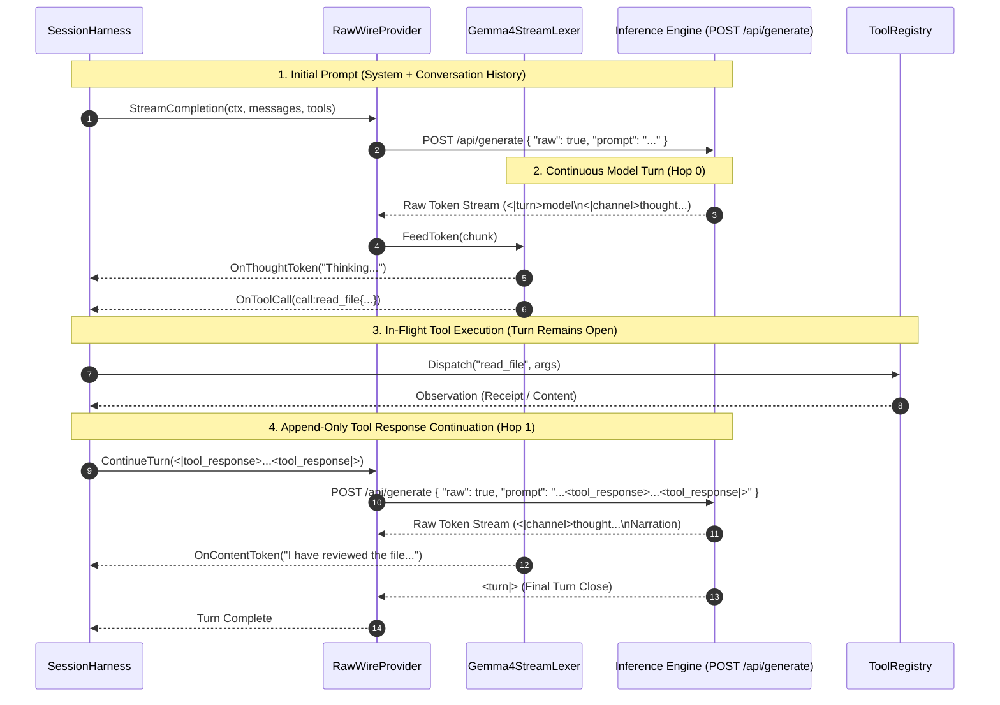
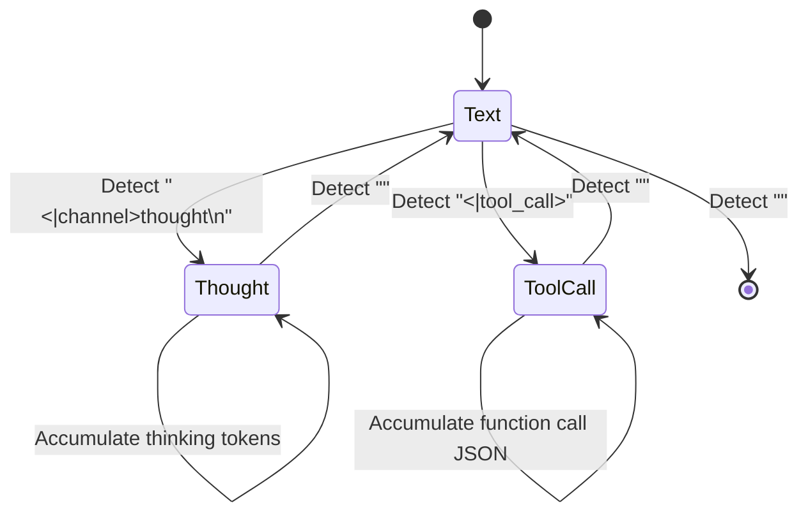

# ADR 024: Raw Wire Inference, Directional Control Token Lexing, and Canonical Tool-Loop Streaming

## Status

Accepted

---

## Context

Prior to `v0.3.2`, all LLM interactions in `please` were routed through high-level chat completion endpoints (`POST /api/chat` in Ollama and OpenAI-compatible drivers). These drivers relied on server-side Jinja2 templating engines to serialize structured messages (`[]domain.Message`) into token streams.

While convenient for prototyping, relying on opaque server-side chat templates created severe friction when orchestrating advanced agentic loops with modern reasoning models (such as Google Gemma 4):

### 1. The Jinja Template "Black Box"
Chat template abstractions conceal the actual token-level prompt presented to the model's neural network. Server-side templates frequently:
* Inject unexpected Begin-of-Sequence (`<bos>`) or End-of-Sequence (`<eos>`) tokens at arbitrary turn boundaries.
* Introduce spurious leading or trailing whitespace that disrupts token prefixes.
* Obscure how system guidelines, tool schemas, and channel tokens are placed, making it impossible to diagnose why a model burns excessive reasoning tokens or fails to adhere to tool protocols.

### 2. Turn-Bouncing Multi-Step Tool Pathology
Many agentic frameworks employ a ChatML/Qwen convention for multi-step tool execution:
1. The assistant generates a tool call and terminates its turn with `<turn|>`.
2. The harness executes the tool and injects the result into a synthetic user turn (`<|turn>user\n<|tool_response>...<tool_response|><turn|>`).
3. The harness opens a new model turn (`<|turn>model`) to prompt the next hop.

When applied to models like Gemma 4—whose pre-training and fine-tuning explicitly expect continuous multi-step tool interactions—this "turn bouncing" causes attention head disorientation at turn boundaries:
* **Token Leakage and Hallucination**: The model hallucinates tool declaration fragments (such as leading `\n de` from `declaration:`) or premature closing tags.
* **In-Context Self-Amplification**: Because the leaked fragment appears in conversational history, subsequent hops mimic and amplify the glitch (e.g., repeating `de` tokens: $1 \to 1 \to 2 \to 4$).
* **KV-Cache Fragmentation**: Artificially closing and reopening turns disrupts append-only attention caching, forcing inference backends to re-evaluate turn boundaries.

### 3. Lack of Reasoning Effort Modulation
Modern instruction-tuned architectures incorporate native reasoning channels (`<|channel>thought`). High-level chat APIs offer no deterministic mechanism to modulate or suppress reasoning effort, forcing users to pay massive token latencies even for trivial file edits or deterministic query responses.

---

## Decision

We introduce a first-class **Raw Wire Inference Architecture** comprising:
1. `RawWireProvider`: Communicates directly with low-level completion endpoints (`POST /api/generate` with `"raw": true`), bypassing server-side Jinja templates entirely.
2. `WireCodec` & `Gemma4Codec`: Client-side serialization and deserialization of directional control tokens according to official model specifications.
3. **Canonical Continuous-Turn Tool Streaming**: Bounding multi-step tool executions within a single continuous `<|turn>model` generation envelope.
4. `Gemma4StreamLexer`: A streaming lexer with sliding lookahead buffers and rehearsal protection to cleanly partition thought, tool call, and narration streams in real time.
5. **Configurable Reasoning Effort**: Deterministic modulation (`off`, `low`, `medium`, `high`) via control tokens and channel suppression.



---

### Detailed Design & Implementation

#### 1. The WireCodec Interface ([`internal/providers/wire/codec.go`](../internal/providers/wire/codec.go))

We formalize wire serialization into a downward-compatible Layer 1 package:

```go
type WireCodec interface {
    Name() string
    FormatSystemTurn(instructions string, tools []domain.ToolSpec) string
    FormatUserTurn(content string) string
    FormatModelTurn(content string) string
    FormatToolCall(call domain.ToolCall) string
    FormatToolResponse(callID string, response string) string
    NewStreamLexer() StreamLexer
}
```

#### 2. Canonical Gemma 4 Continuous Tool Grammar ([`internal/providers/wire/gemma4.go`](../internal/providers/wire/gemma4.go))

In strict adherence to Google's canonical `chat_template.jinja`, multi-step tool calls do **not** close the model turn:

```text
<|turn>model
<|channel>thought
Analyzing target workspace and determining required file inspections...
<channel|><|tool_call>call:read_file{"path": "cmd/please/main.go"}<tool_call|><|tool_response>{"content": "package main..."}<tool_response|>
<|channel>thought
Reviewing main.go logic and formulating final user response...
<channel|>The entrypoint initializes the CLI commands and mounts the runtime harness.<turn|>
```

* **Zero Turn Closures Between Hops**: `<turn|>` is emitted exclusively when the model has concluded all reasoning and tool interactions, and has finalized its spoken dialogue to the operator.
* **Strict Append-Only Continuity**: Because the prompt prefix between Hop 0 and Hop 1 is strictly monotonic and unmodified, local KV-caches achieve a 100% cache hit rate for preceding turns and in-flight thought channels.

#### 3. Stream Lexing and Rehearsal-Buffer Protection

`Gemma4StreamLexer` tracks state transitions across arbitrary network chunk boundaries:



* **Lookahead Buffer**: A rolling FIFO buffer absorbs multi-byte UTF-8 sequences and split control tokens (e.g., `<|chan` received in Chunk A and `nel>thought` in Chunk B) without prematurely emitting raw control characters into the TUI.
* **Delimiter Sanitization**: Trailing artifact fragments (such as `\n de` or stray `declaration:` prefixes) are stripped during lexing, preventing in-context contagion from polluting subsequent turns in the SQLite DAG.
* **Thought Isolation**: Tokens emitted inside `<|channel>thought` are routed exclusively to `OnThought` callbacks (rendered in the TUI's collapsible thinking drawer) and are segregated from `domain.Node.Content`.

#### 4. Explicit Reasoning Effort Modulation

Reasoning budgets are enforced deterministically:
* `off`: System instructions mandate immediate direct answers, and the lexer suppresses empty `<|channel>thought` envelopes.
* `low`: Prompts constrain thinking to concise step enumeration.
* `medium` / `high`: Permits unbounded deep chain-of-thought exploration for complex debugging and architectural tasks.

---

## Consequences

### Positive

* **Elimination of Jinja Template Drift**: The prompt fed to the model is identical byte-for-byte to what the harness assembled; zero hidden formatting surprises.
* **100% KV-Cache Efficiency**: Preserves append-only monotonicity throughout multi-hop tool execution within a turn. Prefill latency for tool continuation hops drops to near-zero.
* **Eradication of Token Leakage**: Stray syntax fragments (`\n de`) are eliminated at the grammar level, ensuring clean DAG node history.
* **Clean Telemetry Separation**: Terminal users see real-time thought streams cleanly segregated from tool execution badges and conversational narration.

### Negative & Trade-offs

* **Codec Maintenance Burden**: Adding support for non-Gemma model families (e.g., Claude, DeepSeek, Qwen) requires maintaining dedicated `WireCodec` and `StreamLexer` implementations in `internal/providers/wire/`.
* **String Allocation Overhead**: Parsing raw token streams introduces minor heap allocations for sliding lookahead buffers, though hermetic benchmarks show this overhead is negligible (<1ms) compared to network token arrival rates.

---

## Related Decisions

* [ADR 006: Modular Providers Extraction](006-modular-providers-extraction.md) — Initial decomposition of provider drivers.
* [ADR 019: Lifecycle Convergence and Canonical Harness Standardization](019-lifecycle-convergence-and-canonical-harness-standardization.md) — Unification of turn execution lifecycles in `SessionHarness`.
* [ADR 020: Cache-Stable Context Shaping and Pure Prompt Projections](020-cache-stable-context-shaping-and-pure-prompt-projections.md) — Monotonic prefix invariance for prompt reconstruction.
* [ADR 025: Cache-Stable Prompt Projections and Temporal Pinning](025-cache-stable-prompt-projections-and-temporal-pinning.md) — System prompt inversion and ambient metadata pinning.
