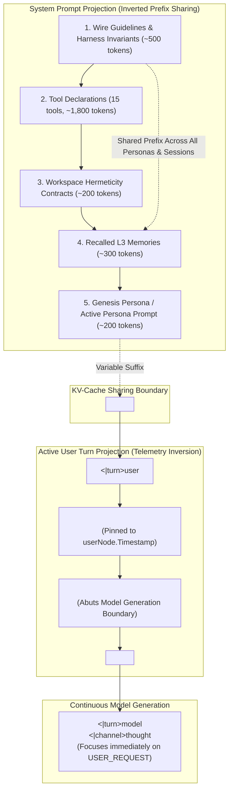

# ADR 025: Cache-Stable Prompt Projections, System Prefix Sharing, and Temporal Pinning

## Status

Accepted

---

## Context

In [ADR 020](020-cache-stable-context-shaping-and-pure-prompt-projections.md), `please` eliminated wall-clock time decay from the `ContextShaper` projection interface in favor of topological graph distance and token fill ratios.

However, prolonged profiling of local inference engines (Ollama, vLLM, llama.cpp) and inspection of attention allocation in reasoning models revealed four subtle prompt projection flaws that continued to invalidate KV caches, distort model focus, or sever workspace awareness mid-turn:

### 1. Persona-First System Prompt Fragility (Prefix Cache Invalidation)
The system prompt was historically assembled with the Genesis Persona at the very top:
```text
[Genesis Persona: "You are George..."] 
  -> [Harness Invariants & Wire Guidelines] 
  -> [Tool Declarations (15 tools, ~2,000 tokens)] 
  -> [Workspace Contracts] 
  -> [Recalled Memories]
```
This ordering introduced two major drawbacks:
1. **Zero KV-Cache Prefix Reuse Across Personas**: When an operator switched personas (via `/persona`) or adjusted persona directives, token 0 of the entire prompt changed. The entire ~2,500-token system block—containing invariant wire rules and static tool schemas—had to be completely recomputed by the GPU.
2. **Attentional Diffusion**: Burying the agent's persona under 15 tool declarations and workspace guidelines placed the agent's core identity thousands of tokens away from the active dialogue, degrading persona fidelity.

### 2. Leaf Telemetry Ordering vs. Attentional Drift
In `FormatTelemetryEnvelope`, the active user turn was formatted with the user query first and environment telemetry second:
```text
<USER_REQUEST>
What is the status of the test suite?
</USER_REQUEST>
<ADDITIONAL_METADATA>
Working Directory: /Users/...
Git Branch: main
Files in Tree: ...
</ADDITIONAL_METADATA>
```
Because the metadata envelope directly preceded the generation boundary (`<|turn>model\n<|channel>thought`), modern reasoning models allocated their primary attention to ambient environment telemetry (such as git status or directory listings) rather than the operator's actual instruction.

### 3. Wall-Clock Drift and Telemetry Evaporation Across Intra-Turn Hops
During multi-step tool execution within a turn (e.g., Turn $N$, Hop 0 $\to$ Hop 1 $\to$ Hop 2):
* **Timestamp Shivering**: Ambient telemetry was generated using unpinned `time.Now()`. As elapsed execution time ticked between hops, `local_time` mutated by seconds or minutes, altering prompt bytes and invalidating the KV-cache prefix for subsequent hops.
* **Telemetry Evaporation**: Telemetry was gated on topological distance $\Delta d = 0$. When the harness appended an assistant node (`RoleAssistant`, tool call) to the DAG, the user node became $\Delta d = 1$. Consequently, on Hop 1, the shaper stripped the `<ADDITIONAL_METADATA>` envelope entirely. The model suddenly lost awareness of its working directory, git branch, and editor context right in the middle of a multi-step refactoring task.

### 4. Multi-Tool Segment Mapping Asymmetry
When a model generated multiple tool calls in a single step (e.g., parallel `read_file` calls), the engine lacked granular segment mapping to align pre-tool narration, individual tool calls, and post-tool syntheses into clean DAG nodes.

---

## Decision

We refine the prompt projection pipeline across `internal/engine/shaper.go` and `internal/engine/telemetry.go`:

1. **System Prompt Inversion**: Place invariant harness rules and tool declarations *first*, followed by recalled memories, placing the Genesis Persona *last* immediately before `<turn|>`.
2. **Leaf Telemetry Inversion**: Place `<ADDITIONAL_METADATA>` *before* `<USER_REQUEST>`, ensuring the human query directly abuts the model generation boundary.
3. **Temporal Pinning & Active User Tracking**: Pin telemetry timestamps to `userNode.Timestamp` via `DeriveAmbientTelemetryAt` and anchor distance calculations to the initiating user node across all intra-turn hops.
4. **Multi-Tool Segment Unpacking**: Track `ToolCount` on `AssistantSegment` to maintain 1:1 narration-to-tool DAG alignment.



---

### Detailed Design & Implementation

#### 1. System Prompt Inversion ([`internal/engine/shaper.go`](../internal/engine/shaper.go))

The system message is projected in order of increasing volatility:

1. **Harness Wire Guidelines & Behavioral Contracts**: Strictly static across all sessions.
2. **Tool Declarations & JSON Schemas**: Static across all standard sessions.
3. **Workspace Hermeticity Context**: Changes only on workspace switch.
4. **Recalled Semantic Memories (L3)**: Dynamic per topic.
5. **Genesis Persona Prompt**: Placed at the very end of the system block.

**Impact**: Over 85% of the system prompt prefix (~2,500 tokens) remains identical across different personas (`/persona george`, `/persona coder`). Switching personas alters only the final ~200 tokens of the system turn, drastically reducing prefill latency. Furthermore, the persona prompt enjoys maximal recency salience right before conversation history begins.

#### 2. Leaf Telemetry Inversion ([`internal/engine/telemetry.go`](../internal/engine/telemetry.go))

The prompt format is inverted so that ambient telemetry acts as background environment framing, while the operator's request is the immediate trigger:

```text
<|turn>user
<ADDITIONAL_METADATA>
Working Directory: /Users/bart/Code/please
Git Branch: kbartley/v0.3.2-refinement-of-ideas
Local Time: 2026-10-16 11:30:00 PDT
</ADDITIONAL_METADATA>
<USER_REQUEST>
Implement the raw wire provider for Ollama.
</USER_REQUEST><turn|>
```

The model's `<|channel>thought` now reads the environment first, absorbs the query last, and immediately plans how to address the user request without getting sidetracked by file lists.

#### 3. Temporal Pinning Across Intra-Turn Tool Hops

We replace non-deterministic `time.Now()` calls with `DeriveAmbientTelemetryAt`:

```go
func DeriveAmbientTelemetryAt(pinnedTime time.Time, workspaceRoot, gitBranch string, ...) string
```

* **Timestamp Pinning**: The ambient telemetry block is stamped with the `userNode.Timestamp`. Throughout Hop 0, Hop 1, and Hop $N$ of a tool-execution turn, the serialized metadata envelope remains 100% byte-for-byte identical.
* **Active User Anchoring**: `ContextShaper` tracks `activeUserIdx` (the initiating user node of the active turn). Even when intermediate `RoleAssistant` and `RoleTool` nodes are appended to the DAG, the active user node continues to receive the `<ADDITIONAL_METADATA>` envelope, guaranteeing that the model retains working directory and git context until the turn concludes.

#### 4. Multi-Tool Segment Unpacking ([`internal/engine/service.go`](../internal/engine/service.go))

To cleanly unpack turns where the LLM dispatches multiple tool calls in a single generation step:

```go
type AssistantSegment struct {
    Content      string
    Thinking     string
    ToolCall     *domain.ToolCall
    ToolCount    int
    IsFinalChunk bool
}
```

The harness inspects `ToolCount` to construct distinct narration, tool call, and tool observation nodes in the DAG, preserving exact 1:1 attribution in session history.

---

## Consequences

### Positive

* **High KV-Cache Hit Rate on Persona Switches**: Swapping agent personas no longer invalidates the static tool and invariant prefix, reducing TTFT (time-to-first-token) from seconds to milliseconds.
* **Attentional Alignment**: Models focus immediately on the user's intent rather than perseverating on ambient file listings.
* **Stable Intra-Turn Context**: Multi-hop tool executions preserve the exact same prompt prefix, eliminating prefix shivering and cache misses across tool hops.
* **Persistent Workspace Awareness**: Intermediate tool hops retain the complete ambient metadata envelope, preventing the model from losing its working directory mid-turn.

### Negative & Trade-offs

* **Projection Complexity**: `ContextShaper` implementations must track both the current DAG head and the active turn's root user node to anchor telemetry and distance calculations.

---

## Related Decisions

* [ADR 014: Persistent Agent Memory and Cybernetic Recall](014-persistent-agent-memory-and-cybernetic-recall.md) — L3 memory recall integration.
* [ADR 020: Cache-Stable Context Shaping and Pure Prompt Projections](020-cache-stable-context-shaping-and-pure-prompt-projections.md) — Foundation of monotonic prefix invariance and topological context shaping.
* [ADR 021: Tiered Sensory Storage and Observation Compaction](021-tiered-sensory-storage-and-observation-compaction.md) — SmartReceipt compaction for tool observations.
* [ADR 024: Raw Wire Inference, Directional Control Token Lexing, and Canonical Tool-Loop Streaming](024-raw-wire-inference-and-canonical-tool-loop-streaming.md) — Raw wire streaming and continuous model turn execution.
