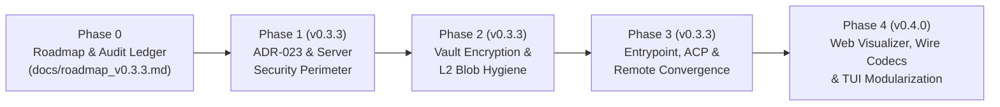

# 🦉 Please v0.3.3 & v0.4.0 Roadmap: Security Perimeter, Lifecycle Hardening & Next Horizons

## Executive Summary

Following the `v0.3.2` refinement milestone (Raw Wire inference via [ADR-024](../decisions/024-raw-wire-inference-and-canonical-tool-loop-streaming.md) and cache-stable prompt projections via [ADR-025](../decisions/025-cache-stable-prompt-projections-and-temporal-pinning.md)), a comprehensive codebase audit identified one outstanding architectural decision record ([ADR-023](../decisions/023-subprocess-recursion-guardrails-and-self-hosting-isolation.md), still `Proposed` and unimplemented in Go code) alongside several concrete security, storage, entrypoint convergence, and protocol seams.

This document serves as the **authoritative engineering ledger** across two release tracks:
* **`v0.3.3` (Phases 1–3)**: Security perimeter completion (ADR-023 + server confinement), vault encryption & L2 storage hygiene, and CLI/ACP/Remote/Raw-Wire convergence.
* **`v0.4.0` (Phase 4)**: TUI command modularization, live SSE web visualizer, and multi-model `WireCodec` + parallel subagent fan-out.

---

## Phase 1 (`v0.3.3`): ADR-023 Self-Hosting Security Perimeter & Server Confinement

### 1.1 Configuration Quarantine (`.please/config.json`) & Symlink Walk Hardening
* **Finding**: `SensitivePathPatterns` in [`internal/tools/sandbox.go`](../internal/tools/sandbox.go#L11-L23) quarantines `vault.db`, `.env`, `.ssh`, etc., but omits `config.json`. Under `standard` sandbox policy, an agent can read credentials/endpoints from `.please/config.json` or mutate `"sandbox_policy"` to `"permissive"` or inflate `"max_tool_depth"`. Additionally, `walkSensoryTree` in [`internal/tools/sense.go`](../internal/tools/sense.go#L57-L92) only checks `isQuarantinedPath(name)` on directory entries, without resolving symlinks inside the tree before reading files during `grep_search` or `list_files_recursive`.
* **Fix**:
  1. Add `"config.json"` to `SensitivePathPatterns` in `internal/tools/sandbox.go`.
  2. In `walkSensoryTree`, validate symlinked entries (`d.Type()&os.ModeSymlink != 0`) via `ValidateSafePath(root, path)` and skip any entry that escapes the root or resolves to a quarantined target.
* **Verification**: Unit tests in `internal/tools/sandbox_test.go` verifying `ValidateSafePath` blocks `"config.json"`, `".please/config.json"`, and symlinks to `config.json`, plus `grep_search` skipping `config.json` and quarantined symlink targets.

### 1.2 Dispatch-Level `SandboxPolicy` Enforcement
* **Finding**: `ToolRegistry.RegisterDefaults` registers Sensory, Mutate, and Exec tools into `ToolRegistry.Tools`, relying only on `GetToolSpecsForPolicy` ([`internal/tools/registry.go`](../internal/tools/registry.go#L175-L202)) to hide disabled tool declarations from the LLM. Neither `ToolRegistry.Dispatch` ([`internal/tools/registry.go`](../internal/tools/registry.go#L119-L135)) nor `SessionHarness.ExecuteTurn` ([`internal/engine/harness.go`](../internal/engine/harness.go#L557)) validates the active `SandboxPolicy` before execution. A model emitting a raw `<call>execute_command...</call>` tag (extracted by `ExtractContentToolCalls` at `internal/engine/harness.go:388`) can bypass `standard` or `strict` mode.
* **Fix**:
  1. Add `IsToolAllowedForPolicy(t Tool, policy string) bool` and `DispatchWithPolicy(ctx, policy, name, rawArgs)` to `internal/tools/registry.go`.
     * `strict`: allows only `t.Category == domain.CategorySensory`.
     * `standard`: prohibits `execute_command` under all circumstances.
     * `permissive`: allows all registered tools.
  2. Add `Manager.ExecuteToolCallWithPolicy(ctx, policy, call)` in `internal/engine/service.go`.
  3. Enforce `IsToolAllowedForPolicy` in `SessionHarness.ExecuteTurn` **before** invoking `PermissionGate` and dispatch via `ExecuteToolCallWithPolicy`, so policy-prohibited calls fail immediately without prompting the operator.
* **Verification**: `TestToolRegistry_DispatchWithPolicy` in `internal/tools/registry_test.go` and `TestSessionHarness_RawCallTagBlockedByPolicy` in `internal/engine/harness_test.go`.

### 1.3 Subagent Capability Intersection & `PermissionGate` Inheritance
* **Finding**: In [`SubagentOrchestrator.SpawnSubagent`](../internal/engine/delegate.go#L103-L110), requesting `tool_preset: "full"` registers `ExecTools` (`execute_command`) on the child registry even when the parent session operates under `standard` or `strict` policy. Furthermore, [`NewSubagentHarness`](../internal/engine/harness.go#L99-L106) sets `PermissionGate: nil`, allowing a child subagent to run up to 25 `execute_command` invocations without operator confirmation.
* **Fix**:
  1. Bound child capability registration by `min(ParentPolicy, ToolPreset)`:
     * `parentPolicy == "strict"`: child receives `SensoryTools` only (`strict` policy).
     * `parentPolicy == "standard"`: child receives `SensoryTools` + `MutateTools` (inside isolated worktree when `tool_preset != "read_only"`), **never** `ExecTools` (`execute_command`).
     * `parentPolicy == "permissive"` and `tool_preset == "full"`: child receives `SensoryTools` + `MutateTools` + `ExecTools`.
  2. Propagate `ParentHarness.PermissionGate` (wrapped with the child's `sub_<id>` session ID) into `NewSubagentHarness` so interactive `CategoryExecute` calls inside subagents still invoke operator consent.
* **Verification**: `TestSubagentOrchestrator_PolicyCeilingAndGateInheritance` in `internal/engine/delegate_test.go`, plus updating existing `execute_command`-using scenarios (`scenarios_test.go`, `raw_wire_scenario_test.go`) to explicitly set `SandboxPolicyPermissive`.

### 1.4 Cross-Process Recursion Sentinels (`PLEASE_HARNESS_DEPTH` & `PLEASE_PARENT_SESSION`)
* **Finding**: [`sanitizeEnvironment()`](../internal/tools/exec.go#L31-L63) strips all `PLEASE*` environment variables from subprocesses, leaving an OS child spawned via `execute_command` (`go run ./cmd/please ...` or `./bin/please ...`) unaware it runs inside an active `please` turn. This enables an out-of-band process fork-bomb and concurrent writes to the active parent session head in SQLite `vault.db`.
* **Fix**:
  1. Define `EnvHarnessDepth = "PLEASE_HARNESS_DEPTH"` and `EnvParentSession = "PLEASE_PARENT_SESSION"` in `internal/tools/exec.go`. In `ExecuteCommandTool`, read current `PLEASE_HARNESS_DEPTH` (default 0), increment it, and inject `PLEASE_HARNESS_DEPTH=<depth+1>` and `PLEASE_PARENT_SESSION=<sessionID>` into `cmd.Env`.
  2. Add `IsSubprocessRecursion() (depth int, parentSession string, active bool)` in `internal/engine/harness.go` (exempting `go test` binaries via `flag.Lookup("test.v") != nil` unless `PLEASE_ENFORCE_DEPTH_IN_TEST=1` is set).
  3. When `IsSubprocessRecursion()` is active:
     * `NewSessionHarness` forces `IsSubagent = true` and strips `execute_command`, `spawn_subagent`, and `reconcile_subagent` from the tool registry.
     * `SessionHarness.ExecuteTurn` and `cmd/please/main.go` message mode reject mutations targeting `PLEASE_PARENT_SESSION`.
* **Verification**: `TestExecuteCommandTool_RecursionSentinels` in `internal/tools/exec_test.go` and `TestSessionHarness_SubprocessRecursionGuard` in `internal/engine/harness_test.go`.

### 1.5 Daemon `/api/image` Path Confinement & CORS Hardening
* **Finding**: [`Server.handleImage`](../internal/server/server.go#L688-L728) (`GET /api/image?path=...`) calls `os.ReadFile(imagePath)` directly without `ValidateSafePath` or image extension verification. Paired with `Access-Control-Allow-Origin: *` in [`corsMiddleware`](../internal/server/server.go#L297-L310), any external web page can probe and read arbitrary host files (`~/.ssh/id_ed25519`, `.please/config.json`) when the local daemon runs without a bearer token.
* **Fix**:
  1. Confine `handleImage` via `tools.ValidateSafePath(wsDir, imagePath)` and enforce an explicit allow-list of image extensions (`.jpg`, `.jpeg`, `.png`, `.gif`, `.webp`, `.svg`), returning `403 Forbidden` on violations.
  2. Replace wildcard `Access-Control-Allow-Origin: *` in `corsMiddleware` with origin validation (`localhost`, `127.0.0.1`, `::1`, `[::1]`, `*.local`), echoing `Origin` + `Vary: Origin` only for trusted local origins and rejecting untrusted `OPTIONS` preflights with `403 Forbidden`.
* **Verification**: `TestServer_HandleImage_PathConfinement` and `TestServer_CORS_OriginConfinement` in `internal/server/server_test.go`.

---

## Phase 2 (`v0.3.3`): Vault Encryption Completeness & L2 Storage Hygiene

### 2.1 `observation_blobs` AES-256-GCM Encryption
* **Finding**: [`SQLiteStorage.SaveObservationBlob`](../internal/storage/sqlite.go#L1190-L1229) and `GetObservationBlob` store and read compressed tool payloads in cleartext even when `s.encryptionKey != ""`, breaking zero-knowledge rest encryption established for `nodes` and `memories`. [`decryptSQLiteVault`](../cmd/please/vault.go#L197-L353) likewise only decrypts `nodes` and `memories`.
* **Fix**: Encrypt base64/binary gzip payloads via `EncryptField`/`DecryptField` when `s.encryptionKey != ""` in `SQLiteStorage`, and extend `please vault decrypt` to decrypt `observation_blobs` rows.
* **Verification**: Encrypted `observation_blobs` round-trip tests in `internal/storage/blob_test.go` and CLI vault decryption tests in `cmd/please/vault_test.go`.

### 2.2 Eliminate Double Observation Persistence & Purge Orphaned Blobs
* **Finding**: [`SessionHarness.ExecuteTurn`](../internal/engine/harness.go#L569-L598) stores raw observation bytes in `observation_blobs` **and** stores the full raw `Result` in `nodes.observations`, causing SQLite row bloat despite [ADR-021](../decisions/021-tiered-sensory-storage-and-observation-compaction.md). Additionally, [`SQLiteStorage.GarbageCollect`](../internal/storage/sqlite.go#L305-L319) deletes soft-pruned `nodes` without running `CleanObservations` to purge orphaned `observation_blobs`.
* **Fix**: Compact/evict large raw `Result` payloads from `nodes.observations` once durably backed by `observation_blobs` (retaining compact receipts + `BlobID`, with `inspect_receipt` dereferencing blobs on demand), and invoke orphaned `observation_blobs` cleanup inside `GarbageCollect()`.
* **Verification**: Storage size and `inspect_receipt` round-trip assertions in `internal/storage/` and `internal/engine/`.

### 2.3 Orphaned Subsession Branch & Worktree Cleanup
* **Finding**: Crashed or unreconciled delegated sessions leave behind `subsession/sub_*` git branches and stale worktree directories.
* **Fix**: Extend `please vault clean` and worktree management utilities to identify and prune orphaned `subsession/sub_*` branches/worktrees no longer tied to active sessions.

---

## Phase 3 (`v0.3.3`): Entrypoint, ACP, Remote & Raw-Wire Convergence

### 3.1 Unified Manager Configuration (`mgr.ApplyConfig`)
* **Finding**: Configuration wiring across CLI entrypoints has drifted:
  * `runServe` ([`cmd/please/main.go`](../cmd/please/main.go#L469-L473)), `runACP` ([`cmd/please/acp.go`](../cmd/please/acp.go#L107-L110)), and `setupDiagnosticsManager` ([`cmd/please/diagnostics.go`](../cmd/please/diagnostics.go#L57-L64)) do not set `mgr.ContextShaperType = cfg.GetContextShaper()`.
  * Standalone `main()` ([`cmd/please/main.go`](../cmd/please/main.go#L249-L253)) and `runACP` do not propagate `*cfg.Server.Options.NumCtx` into `mgr.NumCtx`, leaving capacity calculations stuck on the hardcoded `32768` default.
* **Fix**: Extract a canonical `Manager.ApplyConfig(cfg *config.Config)` (or `engine.ConfigureManager(mgr, cfg)`) helper and call it uniformly across standalone TUI, `serve`, `acp`, and diagnostics commands.

### 3.2 Diagnostic Scorecard Alignment
* **Finding**: `please inspect` ([`cmd/please/diagnostics.go`](../cmd/please/diagnostics.go#L308-L340)) hardcodes `mgr.CalculateResonanceScore(...)` for its ASCII scorecard regardless of the active `ContextShaper` (`sigmoid`, `window`, `exponential`).
* **Fix**: Expose tier/score inspection from the active `ContextShaper` so `please inspect` reflects the true active shaper strategy.

### 3.3 One-Shot CLI Execution via `SessionHarness`
* **Finding**: CLI prompt/stdin execution ([`cmd/please/main.go`](../cmd/please/main.go#L326-L345)) calls `provider.GenerateResponse(context.Background(), messages, nil)` directly with `nil` tools, bypassing `SessionHarness` ([ADR-019](../decisions/019-lifecycle-convergence-and-canonical-harness-standardization.md)).
* **Fix**: Route non-`--no-gen` one-shot CLI turns through `SessionHarness.ExecuteTurn` (respecting `IsSubprocessRecursion()` and `PermissionGate`) so CLI invocations share the canonical tool/receipt/subagent pipeline.

### 3.4 ACP Session Workspace Isolation
* **Finding**: [`Agent.Prompt`](../internal/acp/agent.go#L352-L361) updates `turnCfg.Server.WorkspaceDir = sCwd` per ACP session, but passes the shared `a.mgr` (whose `ToolRegistry` remains bound to startup `workspaceDir`) into `NewSessionHarness`.
* **Fix**: Use `a.mgr.CloneWithWorkspace(sCwd)` when a session's `cwd` differs from `a.mgr.WorkspaceDir`.

### 3.5 `RemoteDaemonStorage` Parity
* **Finding**:
  * [`RemoteDaemonStorage.GarbageCollect`](../internal/storage/remote.go#L128-L145) decodes `deleted_nodes`, whereas [`Server.handleGC`](../internal/server/server.go#L638-L641) returns `purged_records`—causing remote `/gc` to always report `0`.
  * `RemoteDaemonStorage` does not implement `MemoryStore` or `ObservationStore`, limiting `please connect` parity with standalone mode.
* **Fix**: Align the `GarbageCollect` JSON response contract and add remote REST endpoints for `memories` and `observation_blobs` receipts.

### 3.6 `RawWireProvider` Multimodal Support
* **Finding**: `ollamaRawGenerateRequest` in [`internal/providers/raw_wire.go`](../internal/providers/raw_wire.go#L122-L128) omits `Images []string`, dropping image attachments when using `ollama-raw`.
* **Fix**: Encode image attachments into `ollamaRawGenerateRequest` (matching `OllamaProvider`) with unit test verification in `internal/providers/raw_wire_test.go`.

---

## Phase 4 (`v0.4.0`): Strategic Horizons

1. **TUI Command Modularization**: Split the ~51 KB [`internal/tui/commands.go`](../internal/tui/commands.go) monolith into domain-focused modules (`commands_config.go`, `commands_session.go`, `commands_memory.go`, `commands_worktree.go`).
2. **Daemon Observability & Live SSE Web Visualizer**: Upgrade [`internal/server/assets/index.html`](../internal/server/assets/index.html) to subscribe to `/api/v1/events` SSE for real-time token/thought/tool streaming, `SmartReceipt` drawer inspection, and interactive session/subagent branch visualization (retiring legacy `sd_prompt` UI remnants).
3. **Multi-Model `WireCodec` & Parallel Subagent Fan-Out**: Extend `internal/providers/wire/` beyond Gemma 4 (e.g. `ChatMLCodec` / `QwenCodec`) and support concurrent subagent dispatch for read-only audits or competing worktree prototypes.
