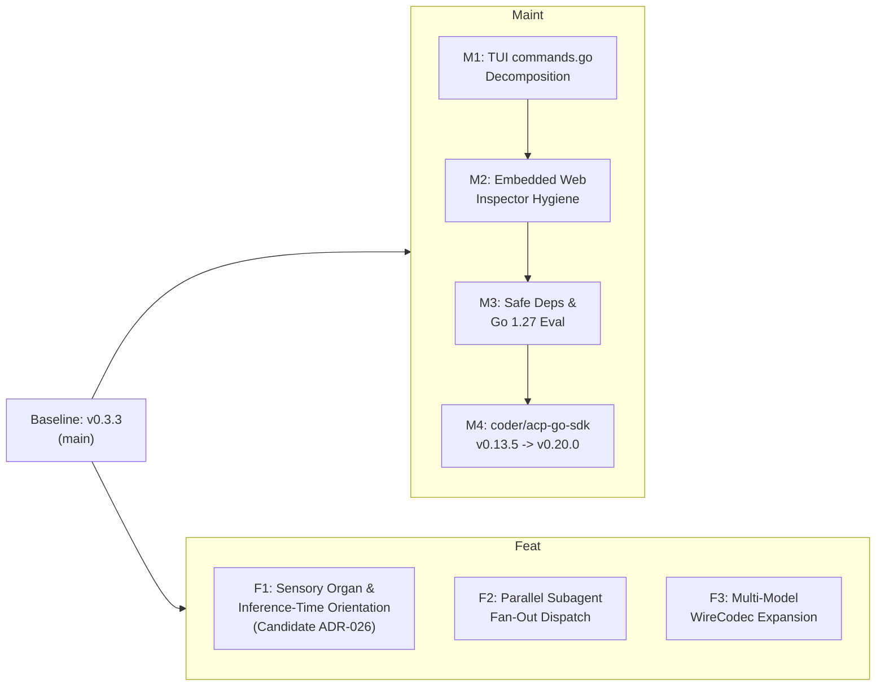

# 🦉 Please v0.4.0 Roadmap: Maintenance Track & Next-Horizon Features

## Executive Summary & Baseline (`v0.3.3`)

With [`v0.3.3`](roadmap_v0.3.3.md) merged and tagged on `main` (ADR-023 self-hosting security boundaries, complete encrypted vault & `observation_blobs` hygiene, `Manager.ApplyConfig`, ACP session workspace isolation, `RemoteDaemonStorage` REST parity, and multimodal `RawWireProvider`), the runtime foundation is converged and green across all 14 testable Go packages.

Going into **`v0.4.0`**, work is organized cleanly into two parallel tracks so mechanical maintenance and isolated SDK migrations never get entangled with deeper architectural design:

---

## Track A — Maintenance & Platform Hygiene

Low-risk structural refactoring, diagnostic inspector polish, and scoped dependency/SDK upkeep.

### M1: TUI Command Monolith Decomposition (`internal/tui/commands.go`)
* **Scope**: Split the ~51 KB [`internal/tui/commands.go`](../internal/tui/commands.go) monolith into cohesive domain modules while preserving identical runtime behavior:
  * `commands_config.go` (`/config ...`, `/sandbox`, provider/model tuning)
  * `commands_session.go` (`/session`, `/persona`, `/jump`, `/compact`, `/branch` / `/list`, `/mark`)
  * `commands_memory.go` (`/memories`, `/memory`)
  * `commands_worktree.go` (`/worktree`)
* **Goal**: Pure mechanical refactoring with zero behavioral regressions; verify with `go test -count=1 ./internal/tui/...`.

### M2: Embedded Web Inspector Hygiene & Sibling Boundary (`internal/server/assets/index.html`)
* **Architectural Boundary ([ADR-003](../decisions/003-embedded-visualizer.md))**:
  * **Inside `please` (`internal/server/assets/index.html`)**: Keep the embedded web view strictly as a **zero-build, single-file vanilla HTML/JS diagnostic oscilloscope** compiled via `go:embed` (zero Node/npm/Vite dependencies in the Go repo).
  * **Future Interactive Web UI (`please-web`)**: Any rich interactive browser client (TypeScript, bundler, graphical DAG canvas editing, full frontend test harness) belongs in a separate sibling workspace (analogous to [`please-swift`](../../please-swift/index.md)) speaking [`docs/daemon_protocol_spec.md`](daemon_protocol_spec.md) — optionally served later via a `--web-dir` flag on `please serve`.
* **Maintenance Polish in `please`**:
  * Strip legacy `sd_prompt` UI remnants from [`internal/server/assets/index.html`](../internal/server/assets/index.html).
  * Display `SmartReceipt` metadata and active named session heads from `v0.3.3` REST endpoints.
  * Subscribe to `/api/v1/events` SSE (`node_saved`, `branch_pruned`, `branch_compacted`) for live diagnostic auto-refresh during `please serve` debugging.

### M3: Safe Dependency & Go 1.27 Toolchain Modernization
* **Drop-in Module Updates**:
  * `modernc.org/sqlite`: `v1.60.1` $\rightarrow$ `v1.62.0` (brings wrapped driver connection fixes alongside `modernc.org/libc v1.82.3` and `modernc.org/memory v1.13.0`).
  * Indirect patch updates: `golang.org/x/sys` (`v0.50.0`), `golang.org/x/text` (`v0.44.0`), `charmbracelet/x/ansi` (`v0.11.10`), `xo/terminfo` (`v1.3.1`).
* **Go `1.27` Standard Library Evaluation** (currently local toolchain `go1.27.4` with [`go.mod`](../go.mod#L3) pinned to `1.26.2`):
  * Evaluate bumping `go.mod` to `1.27` to adopt stdlib `uuid` (retiring `github.com/google/uuid` and shrinking direct dependencies from 6 to 5), `encoding/json/v2` (`Deterministic(true)` for KV-cache-stable JSON serialization), and GA `runtime/pprof` `goroutineleak` profiling for SSE / ACP / `SessionActor` audits.

### M4: `coder/acp-go-sdk` Migration (`v0.13.5` $\rightarrow$ `v0.20.0`)
* **Isolate in its Own Dedicated PR**: Upstream `v0.14.0`–`v0.20.0` introduces planned breaking API changes (including new `Agent` methods such as `DeleteSession` and signature revisions documented in upstream `MIGRATION_v0.20.md`).
* **Guardrails**: Add compile-time interface assertions in [`internal/acp/agent.go`](../internal/acp/agent.go) so protocol mismatches fail cleanly at compile time rather than returning JSON-RPC `-32601`. Verify across [`internal/acp/agent_test.go`](../internal/acp/agent_test.go) and [`cmd/please/acp_e2e_test.go`](../cmd/please/acp_e2e_test.go).

---

## Track B — Feature Track (Requires ADR Refinement Prior to Implementation)

### F1: Sensory Organ & Inference-Time Orientation *(Highest Immediate Leverage — Candidate ADR-026)*
* **Problem Statement (From `v0.3.3` Design Discussion)**:
  * **System-Prompt Bludgeon**: Injecting `DeriveRecalledMemoriesPrefix` ([`internal/engine/service.go`](../internal/engine/service.go#L1063-L1097)) unconditionally into `<|turn>system` ([`internal/engine/shaper.go`](../internal/engine/shaper.go#L535-L539)) biases every model turn toward whichever 15 `memories` rows happened to be saved, regardless of user intent.
  * **Siloed Sensory Space & Git Blindness**: Under `strict` and `standard` sandbox policies (`execute_command` disabled), a waking model has no safe read-only way to check Git state (`git status`, recent commits) or search past session milestones in `vault.db`.
  * **Anti-Duplication Lesson**: Avoid building a parallel SQLite database of derived code facts (which quickly rot against live code + Git + `read_only` subagents). Keep source code + Git + Scriptorium Markdown (`index.md`, `decisions/`) authoritative for *"what the repo is"*.
* **Proposed Capabilities to Specify in ADR-026**:
  1. **Safe Read-Only Workspace Pulse Tool (`workspace_status` / `git_pulse`)**: Permitted under `strict` and `standard` policies without opening arbitrary shell execution—surfaces working tree changes (`git status --short`), recent commit subjects (`git log -n 10 --oneline`), active session heads, and canonical index anchor (`GEMINI.md` / `index.md`).
  2. **Federated Multi-Source Sensory Search (`search_context` / upgraded `recall`)**: Single inference-time query spanning all orientation strata and returning compact, drillable handles:
     * `[doc]` — `GEMINI.md`, `index.md`, `decisions/ADR-*.md`, `docs/` (`path:line`)
     * `[code]` — Source files and symbols (`path:line`)
     * `[git]` — Recent commits and touched paths (`commit_sha`)
     * `[episode]` — Compacted `RoleSummary` Supernodes & session digests in `vault.db` (`node:short_id`)
     * `[memory]` — Tacit operator preferences, host quirks, and negative knowledge (*"tried X, failed because Y"*) in `memories` (`mem:key`)
  3. **Reframed Cold-Path Harvester & Dialed-Back System Prefix**:
     * Slim `<RECALLED_MEMORIES>` in `<|turn>system` (moving retrieval to pull-based sensory tools and/or relevance-thresholded leaf injection alongside `<ADDITIONAL_METADATA>`, preserving Genesis KV-cache prefix invariance per [ADR-025](../decisions/025-cache-stable-prompt-projections-and-temporal-pinning.md)).
     * Use cold-path harvesting strictly where Git cannot help: distilling completed DAG branches into searchable `[episode]` digests and negative-knowledge entries, merging/pruning redundant `memories`, optionally computing local Ollama `/api/embeddings` over searchable strata (respecting vault encryption boundaries in [`internal/storage/sqlite.go`](../internal/storage/sqlite.go#L842-L857)), and optionally proposing doc-drift updates to Scriptorium Markdown.

### F2: Parallel Subagent Fan-Out Dispatch
* **Scope**: Extend `SessionHarness.ExecuteTurn` ([`internal/engine/harness.go`](../internal/engine/harness.go)) and `SubagentOrchestrator` ([`internal/engine/delegate.go`](../internal/engine/delegate.go)) to allow concurrent dispatch when a single assistant step emits multiple independent `spawn_subagent` calls (e.g., parallel read-only subsystem audits or competing isolated worktree prototypes).
* **Open Design Questions**:
  * Preserve deterministic `ToolCallID` ordering when folding completed `ToolObservation`s back into the continuous turn loop.
  * Serialize `PermissionGate` prompts cleanly if multiple child subagents concurrently request interactive consent under `permissive` mode.
  * Enforce shared parent context cancellation and aggregate step-budget telemetry.

### F3: Multi-Model `WireCodec` Expansion
* **Scope**: Extend [`internal/providers/wire/`](../internal/providers/wire/) beyond `Gemma4Codec` (e.g., ChatML / Qwen / Llama / DeepSeek codecs) while preserving clean lookahead streaming lexers and KV-cache prefix stability ([ADR-024](../decisions/024-raw-wire-inference-and-canonical-tool-loop-streaming.md)).
* **Guiding Constraint**: Anchor each new `WireCodec` implementation against real raw token streams from an active second model family on local Ollama or MLX before locking parser edge cases.

---

## Suggested Fresh-Thread Entrypoints

1. **Quick Mechanical Start (Maintenance)**: Branch `kbartley/v0.4.0-maintenance` (or work sequentially in focused PRs) starting with **M1** (`commands.go` split) + **M2** (`index.html` SSE/receipt cleanup) + **M3** (`modernc.org/sqlite v1.62.0`).
2. **Isolated SDK Upgrade**: Dedicated PR for **M4** (`coder/acp-go-sdk v0.20.0`).
3. **Architecture & Feature Deep-Dive**: Open an ADR session drafting **ADR-026** for **F1 (Sensory Organ & Inference-Time Orientation)** before writing retrieval/harvester code.
